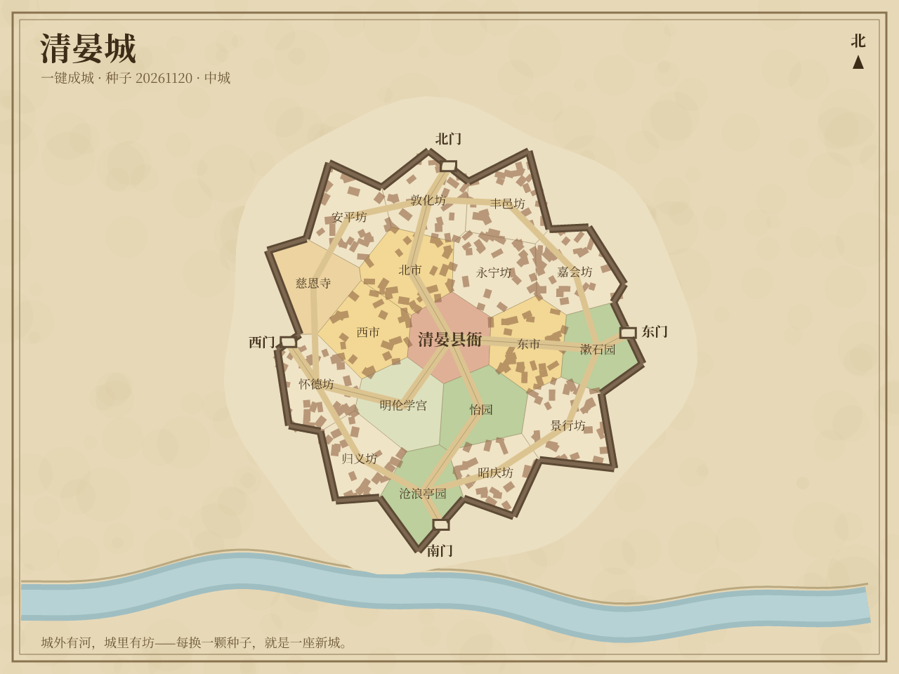

# 一键成城 · yicheng

**点一下，生成一座古城。** 城墙、城门、街道、坊市、寺庙、学宫、园林，全部由程序按「种子」现场算出——同一颗种子永远生成同一座城，换一颗种子，就是另一座城。

[](LICENSE)
[](LICENSE-DOCS)
[](https://go.dev)
[](https://xiaoyu-hue.github.io/yicheng/)

**在线体验**：[xiaoyu-hue.github.io/yicheng](https://xiaoyu-hue.github.io/yicheng/) —— 手机、电脑打开就能玩，生成全在浏览器里完成，不经过任何服务器。



## 功能一览

| 功能 | 说明 |
|---|---|
| 一键生成 | 点「换一座城」，随机种子生成一座全新的城 |
| 种子复现 | 输入种子数字即可重现任意一座城——把种子发给朋友，对方看到的城和你一模一样 |
| 种子链接 | 网址自带种子与规模参数，「复制城链接」一键分享，朋友点开直达那座城 |
| 三种规模 | 小城 / 中城 / 大城，坊数与街网密度随规模变化 |
| 两种格局 | 山水格局（有机坊界、顺势筑城）与棋盘格局（长安风：方正城墙、棋盘街坊、十字大道），一键切换 |
| 护城河与城外景 | 护城河环城、门外有桥，城外散布田垄与村落——城不再是孤岛 |
| 四季皮肤 | 宣纸之外可换春 / 秋 / 冬 / 夜四套配色，只换色板不换布局，分享图花样翻倍 |
| 完整城建 | 城墙与四座城门、门到城心的大道、环城道、坊市分区（县衙、市集、寺庙、学宫、园林、驿站、民居坊），城南有河 |
| 细节填充 | 民居与市集坊内自动散布小屋顶，图上有指北针、城名、种子标注与落款 |
| 双格式下载 | SVG（矢量图，放大不糊，适合打印装裱）与 PNG（2560×1920，适合分享） |
| 确定性保证 | 生成全程由种子驱动，无全局随机、无时间依赖；自带 `-check` 自检，比对同种子两遍输出的哈希 |
| 零依赖 | 仅使用 Go 标准库；单一代码库同时产出本地版（单文件程序）与网页版（WebAssembly） |

## 快速开始

### 使用者

打开[在线体验](https://xiaoyu-hue.github.io/yicheng/)即可，无需安装。详细玩法见[《使用说明》](docs/使用说明.md)。

### 双击版（免安装）

到 [Releases](https://github.com/xiaoyu-hue/yicheng/releases) 下载对应系统的压缩包，解压后双击运行（Windows 为 `yicheng.exe`），浏览器会自动打开游玩页面；关掉程序窗口即退出。

### 本地运行

需要 [Go](https://go.dev/dl/) 1.22 或更高版本：

```bash
git clone https://github.com/xiaoyu-hue/yicheng.git
cd yicheng
go run .          # 打开 http://localhost:8080
```

### 命令行用法

| 参数 | 说明 | 示例 |
|---|---|---|
| `-addr` | 本地服务监听地址（默认 `:8080`） | `go run . -addr :9000` |
| `-seed` | 导出指定种子的城（配合 `-out`，不启动服务） | `go run . -seed 42 -out city.svg` |
| `-size` | 规模：`town` 小城 / `city` 中城（默认）/ `capital` 大城 | `go run . -seed 42 -size capital -out big.svg` |
| `-mode` | 格局：`organic` 山水（默认）/ `grid` 棋盘 | `go run . -seed 42 -mode grid -out grid.svg` |
| `-theme` | 皮肤：空 宣纸（默认）/ `spring` 春 / `autumn` 秋 / `winter` 冬 / `night` 夜 | `go run . -seed 42 -theme night -out night.svg` |
| `-out` | 导出 SVG 到文件 | 见上 |
| `-check` | 自检：同种子生成两遍并比对哈希，一致则输出 OK | `go run . -check` |

## 它是怎么建城的

建城流水线分五步（思路致敬 Watabou 的程序化城市生成器，本项目的实现为原创代码）：

1. **撒点成坊**：在同心圆环上撒下坊心种子点，用泰森多边形（Voronoi）切出坊界，再经两轮 Lloyd 松弛让坊形匀整；
2. **筑墙开门**：内圈坊的外缘拼成城墙，按与正东 / 正南 / 正西 / 正北方向的贴合度选出四座城门；
3. **铺路成网**：沿坊邻接图做广度优先搜索，得到四门直达城心的大道，再把贴墙的坊心串成环城道；
4. **分坊命名**：城心为县衙，四象限设东西南北四市，其余按规则安置寺庙、学宫、园林与迎送驿，剩下的坊从坊名库里抽签命名；
5. **渲染成图**：宣纸底色、坊块按用途着色、屋顶散布、城南画河，最后输出带城名与种子的 SVG。

**棋盘格局**换的是第 1 步的切法：坊界改为方正网格、城墙取直、街道成十字大道与环城道（衙署居北中、东西两市对峙，长安气象），其余步骤与山水格局共用。两种格局之外还有一层**城外景**：护城河由城界放大成环、门外架桥，田垄与村落由独立的派生种子散布——不扰动城内生成序列，旧种子的城内布局保持不变。

## 架构

三层单向依赖：**入口层**（本地服务 / WebAssembly 两个入口）→ **渲染层**（`render.go`，只把城的数据画成 SVG）→ **核心层**（`city.go`，种子进、城的数据出，纯计算无副作用）。核心层不依赖任何入口与渲染细节，因此同一份生成逻辑可以同时供本地版与网页版使用，两端输出逐字节一致（已用哈希对拍验证）。设计原则与扩展指南见[《架构说明》](docs/架构.md)。

## 项目结构

| 路径 | 职责 |
|---|---|
| `city.go` | 生成核心：种子 → 城的数据结构（两种格局的坊、墙、门、路、河与城外景） |
| `render.go` | SVG 渲染：城的数据结构 → 宣纸风地图 |
| `main.go` | 本地版入口：命令行导出与 HTTP 服务（构建标签排除于网页版） |
| `wasm_main.go` | 网页版入口：向页面暴露 `generateCity(种子, 规模)`（仅 `js/wasm` 构建） |
| `web/index.html` | 本地版页面（由本地服务托管） |
| `docs/index.html` | 网页版页面（GitHub Pages 站点根目录） |
| `docs/yicheng.wasm` | 生成核心的 WebAssembly 构建产物 |
| `docs/sample.png` | 本 README 的样例图 |
| `docs/使用说明.md` | 面向使用者的完整玩法说明 |
| `docs/架构.md` | 架构说明：分层、确定性纪律与扩展指南 |

## 开发

```bash
go build -o yicheng .                        # 构建本地版
go vet ./...                                 # 静态检查
go run . -check                              # 确定性自检（改核心后必跑）
GOOS=js GOARCH=wasm go build -o docs/yicheng.wasm .   # 重新构建网页版
cp "$(go env GOROOT)/lib/wasm/wasm_exec.js" docs/     # Go 大版本升级时同步运行时
```

改动生成核心后，请依次通过三道验证再提交：`go vet` 无报错、`-check` 输出 OK、网页版与本地版同种子输出哈希一致（方法见[《架构说明》](docs/架构.md)）。

## 文档索引

- [使用说明](docs/使用说明.md)：界面、种子玩法、看图图例、常见问题
- [架构说明](docs/架构.md)：分层设计、确定性纪律、扩展指南、已知限制
- [代码许可证](LICENSE)：GPL-3.0 全文
- [文档许可证](LICENSE-DOCS)：GFDL 1.3 全文

## 免责声明

本程序生成的城名、坊名与地图均为算法虚构，与真实地名、机构如有雷同纯属巧合。本项目为娱乐与学习用途，生成的地图不具备测绘、规划或任何专业用途的准确性。

## 致谢

- 建城流水线的分区思路受到 Watabou 程序化城市生成工作的启发，特此致谢；本项目的全部代码为原创实现。
- 感谢 Go 标准库——本项目未引入任何第三方依赖。

## 许可证

- **代码**：[GPL-3.0](LICENSE) —— 可自由使用、修改与再发布，衍生作品须以相同许可证开源并保留版权声明。
- **文档**（本文件、`docs/` 下文档）：[GFDL 1.3](LICENSE-DOCS) —— 可自由复制、分享与改编，须注明出处并附许可证文本，以相同条件继续分享。
